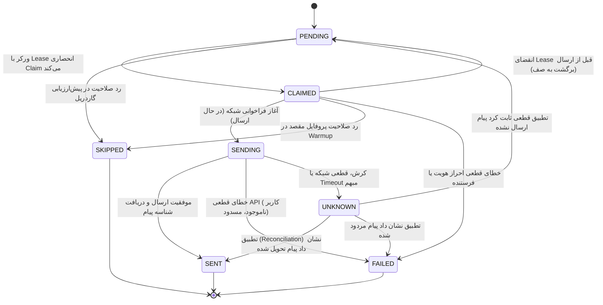

# سند رسمی قرارداد قصد ارسال و ماشین وضعیت (Outreach Intent & State Machine Contract)

## ۱. مشخصات سند و زمینه
- **شناسه تسک:** P04.02
- **یافته‌های مبنا:** R11 (عدم وجود claim پایدار پیش از ارسال و ریس رقابت دو ورکر), R12 (دور زدن محدودیت‌های سهمیه و ریت‌لیمیت فرستنده در مسیر پیگیری)
- **هدف:** تعریف ماشین وضعیت متناهی (FSM)، سیستم اجاره انحصاری (Lease Ownership)، مدیریت تلاش‌ها (Attempt/Generation)، و تحلیل نقاط کرش جهت تضمین قطعی عدم ارسال پیام تکراری (Spam/Double-DM) و شفاف‌سازی وضعیت‌های نامطمئن.

---

## ۲. تعاریف و اصول حاکم بر Intent
1. **هویت قصد ارسال (Intent):** هر عملیات ارسال پیام دارای شناسه یکتای پایدار (`intent_id`) است.
2. **قانون بازآزمایی (Retry) در برابر پیگیری (Follow-up):**
   - **Retry:** تلاش مجدد برای همان پیام ناموفق یا تاییدنشده، ذیل **همان Intent** و با افزایش شمارنده `attempt_count` صورت می‌پذیرد.
   - **Follow-up:** پیام دوم یا پیگیری مشروع مشتری در مکالمه، یک **Intent کاملاً مجزا و جدید** است و تابع سهمیه، ریت‌لیمیت و شرایط زمانی مستقل خواهد بود.
3. **وعده تحویل (Delivery Semantics):**
   - از آنجا که پلتفرم‌های پیام‌رسان خارجی (از جمله اینستاگرام دایرکت) فاقد `Idempotency-Key` سمت سرور هستند، وعده *Exactly-Once* از نظر علمی غیرممکن است.
   - سیستم Dealism/مشتری‌یاب تضمین **At-Most-Once** را برقرار می‌سازد: یعنی تحت هیچ شرایطی پیام تکراری به دلیل خطای شبکه ارسال نمی‌شود و هر وضعیت نامطمئن به جای Retry کورکورانه، وارد وضعیت `UNKNOWN` شده و نیازمند تطبیق است.

---

## ۳. ماشین وضعیت و ماتریس انتقال‌ها (FSM Matrix)

### جدول انتقال‌های مجاز و غیرمجاز

| وضعیت مبدا | وضعیت‌های مقصد مجاز | وضعیت‌های اکیداً ممنوع | دلیل ممنوعیت |
| :--- | :--- | :--- | :--- |
| **PENDING** | `CLAIMED`, `SKIPPED` | `SENDING`, `SENT`, `UNKNOWN` | ورکر باید ابتدا lease انحصاری بگیرد |
| **CLAIMED** | `SENDING`, `PENDING`, `SKIPPED`, `FAILED` | `SENT`, `UNKNOWN` | پیش از شروع ارسال نمی‌توان به موفقیت رسید |
| **SENDING** | `SENT`, `FAILED`, `UNKNOWN` | `PENDING`, `CLAIMED` | بازگشت مستقیم به صف ممکن است پیام تکراری بسازد |
| **UNKNOWN** | `SENT`, `FAILED`, `PENDING` | `CLAIMED`, `SENDING` | خروج از UNKNOWN تنها با تطبیق (Reconciliation) مجاز است |
| **SENT** | *(هیچ - وضعیت پایانی)* | هرگونه تغییر وضعیت | پیام ارسال‌شده غیرقابل تغییر و برگشت است |
| **FAILED** | *(هیچ - وضعیت پایانی)* | هرگونه تغییر وضعیت | شکست قطعی تغییر نمی‌کند؛ پیام جدید intent نو می‌خواهد |
| **SKIPPED** | *(هیچ - وضعیت پایانی)* | هرگونه تغییر وضعیت | کاربر فاقد صلاحیت گاردریل تغییر وضعیت ندارد |

---

## ۴. تحلیل نقاط کرش و شکست (Crash Points Analysis)

1. **نقطه کرش A (قبل از Claim):**
   - اتفاق: سرور یا پردازش قبل از انتخاب لید متوقف می‌شود.
   - وضعیت Intent: در حالت `PENDING` باقی می‌ماند. هیچ پیامی ارسال نشده و در چرخه بعدی اجرا می‌شود.
2. **نقطه کرش B (در وضعیت `CLAIMED` — قبل از ارسال شبکه):**
   - اتفاق: لید توسط ورکر رزرو شده، اما قبل از زدن دکمه ارسال شبکه، پردازش کرش می‌کند.
   - رفتار ایمن: زمان `lease_expires_at` منقضی می‌شود. Intent با `release_expired_claim` به `PENDING` بازمی‌گردد بدون اینکه فرستنده یا گیرنده آسیبی دیده باشند.
3. **نقطه کرش C (در وضعیت `SENDING` — ارسال در شبکه خارجی):**
   - اتفاق: درخواست به اینستاگرام رفته، اما ارتباط قطع شده یا ورکر پیش از دریافت پاسخ کرش می‌کند.
   - رفتار ایمن: سیستم آن را `UNKNOWN` ثبت می‌کند. **ارسال مجدد کورکورانه اکیداً ممنوع است.** در فاز ریکاوری (P04.07)، با متد `reconcile_unknown` تاریخچه دایرکت استعلام شده و در صورت عدم وجود پیام، با افزایش `attempt_count` بازگشت داده می‌شود.
4. **نقطه کرش D (پس از ارسال موفق و قبل از ذخیره نهایی در دیتابیس):**
   - اتفاق: پیام ارسال شد اما تراکنش دیتابیس قطع شد.
   - رفتار ایمن: بررسی تطبیق نشان می‌دهد پیام در دایرکت گیرنده وجود دارد، لذا به وضعیت `SENT` تغییر کرده و از دابل-مسیج جلوگیری می‌شود.

---

## ۵. کنترل سهمیه و ریت‌لیمیت فرستنده (R12)
- سهمیه روزانه (`daily_limit`) و نرخ ساعتی (`hourly_limit`) باید در لحظه `CLAIM` رزرو شوند (Reservation) و در صورت خروج به `PENDING` آزاد گردند.
- تمام پیام‌های پیگیری (Follow-up) باید دقیقاً همانند پیام اول، تابع ساعات کاری (۰۹:۰۰ تا ۲۳:۰۰ تهران)، وضعیت فعال، و سهمیه‌های روزانه/ساعتی فرستنده باشند.
