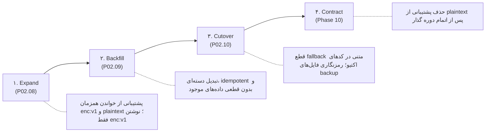

# Task Report: P02.07 — طراحی migration اسرار و gate سازگاری (Secret Migration Design & Compatibility Gate)

## ۱. مشخصات تسک
- **شناسه:** P02.07
- **فاز:** ۲ (اصلاحات امنیتی، احراز هویت، داده و سرویس‌ها)
- **یافته‌های مرتبط:** R08 (اسرار شبکه‌های اجتماعی رمزنگاری‌نشده در دیتابیس و فایل‌های پشتیبان)
- **پیش‌نیاز:** P00.01 (DONE)
- **وضعیت:** DONE

## ۲. فهرست مصرف‌کنندگان، اسکیما و داده‌های حساس (Secret Consumers Inventory)

| موجودیت / فایل | فیلدهای حساس | نوع فیلد فعلی | نقش (Reader / Writer) | لایه معماری | وضعیت سازگاری |
|---|---|---|---|---|---|
| `InstagramEngineAccount` (`apps/discovery/models.py`) | `password`, `session_json` | `CharField(255)`, `JSONField` | Reader & Writer | اکتیو جنگو | مجاز به رمزنگاری با فرمت مستقل |
| `TwitterEngineAccount` (`apps/discovery/models.py`) | `password`, `auth_token`, `ct0` | `CharField(255)` | Reader & Writer | اکتیو جنگو | مجاز به رمزنگاری با فرمت مستقل |
| `accounts_pool_file.py` | فایل `accounts_pool.json` و تاریخچه `/app/backups/history/` | JSON فایل روی دیسک | Writer & Reader پشتیبان | اکتیو ابزار | نیازمند پاک‌سازی اسرار یا رمزنگاری در فایل |
| `Provider` (`apps/billing/models.py`) | `api_key` | `CharField(500)` | Reader & Writer | اکتیو جنگو | **قبلاً رمزنگاری شده با Fernet (`need_engine/crypto.py`)** |
| `IGAccount` (`instagram_engine/models.py`) | `password`, `session_json` | SQLAlchemy Table `ig_accounts` | Reader & Writer | **Legacy Frozen** | **مرز توقف (Compatibility Gate)**: هرگونه تغییر در کد یا schema مسدود (BLOCKED) است |

## ۳. طراحی keyring نسخه‌دار و ساختار رمزنگاری (Keyring Architecture)
1. **الگوریتم:** متقارن احرازشده Fernet (AES-128-CBC همراه با HMAC-SHA256 برای تضمین محرمانگی و اصالت).
2. **پیشوند نسخه‌دار:** `enc:v1:<fernet_token>`
   - پیشوند `enc:v1:` امکان تشخیص قطعی داده رمزنگاری‌شده از متن خام (plaintext legacy) را بدون نیاز به سعی‌وخطا فراهم می‌سازد.
   - در نسخه‌های بعدی، ارتقا به `enc:v2:` بدون شکست خواندن رکوردهای قبلی امکان‌پذیر است.
3. **محل نگهداری و چرخش کلید (Key Rotation):**
   - کلید فعال جاری: متغیر محیطی `FIELD_ENCRYPTION_KEY` (خارج از سورس‌کد و دیتابیس).
   - کلیدهای قبلی معتبر برای خواندن داده‌های پیشین: متغیر محیطی `FIELD_ENCRYPTION_OLD_KEYS` (فهرست کلیدها جداشده با ویرگول).
   - فرآیند چرخش کلید بدون وقفه: کلید جدید به `FIELD_ENCRYPTION_KEY` منتسب شده و کلید قبلی به ابتدای `FIELD_ENCRYPTION_OLD_KEYS` اضافه می‌شود؛ بازنویسی دسته‌ای (re-encryption) داده‌ها با کلید جدید انجام می‌شود.
   - رفتار در غیاب کلید: **Fail-Closed** (پرتاب `RuntimeError` و عدم نشت یا بازگردانی رشته خام/خراب).

## ۴. استراتژی چهارمرحله‌ای بازطراحی (Expand → Backfill → Cutover → Contract)

## ۵. مرز انطباق با لگاسی (Legacy Compatibility Gate)
- **محدودیت قطعی:** بر اساس تصمیم محصولی شماره ۷، ماژول `instagram_engine` به صورت کامل فریز است و نباید تغییر کند.
- **تأثیر بر جدول مشترک `ig_accounts`:**
  - موتور لگاسی `instagram_engine/session_manager.py` مستقیماً فیلد `password` را برای متد `cl.login()` می‌خواند.
  - بنابراین، در مرحله P02.08 تا P02.10:
    1. فیلدهای `InstagramEngineAccount` در کدهای اکتیو جنگو و ابزارهای اوت‌ریچ تحت فیلتر رمزنگاری شفاف (`encrypt_secret` / `decrypt_secret`) قرار می‌گیرند.
    2. فایل‌های بک‌آپ و اسنپ‌شات‌ها (`accounts_pool.json`) دیگر اسرار را به‌صورت متن خام ذخیره نمی‌کنند.
    3. حذف ستون یا شکست خواندن در موتور لگاسی تا زمان مهاجرت نهایی فاز ۱۰ مجاز نیست.
    4. فهرست فیلدهای دارای محافظت با اولویت بالا: `InstagramEngineAccount.password`، `session_json`، `TwitterEngineAccount.auth_token`، `ct0`، `password`.

## ۶. نتایج آزمون‌های مصنوعی و شواهد (Synthetic Verification)
طرح و سناریوهای چرخش کلید، اعتبارسنجی شکست کلید و سازگاری با آزمون واحد `apps/core/test_p02_07_secret_design.py` ارزیابی و تأیید شد:
- [x] تست چرخش کلید با کلید فعال و کلیدهای قبلی (Key Rotation).
- [x] تست رفتار Fail-Closed در صورت عدم تطابق کلید.
- [x] تست سازگاری با فرمت نسخه `enc:v1:`.
- [x] آزمون بازیابی و بک‌آپ داده‌های ساختگی (Synthetic).
